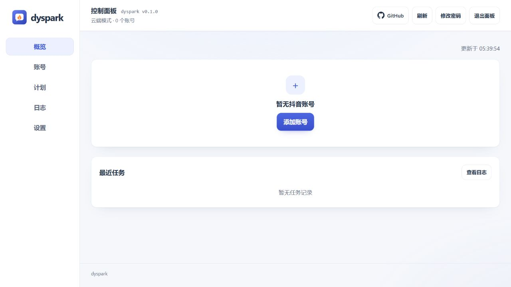

# dyspark · 抖音续火花助手

**集中管理多个抖音账号，为指定好友和群聊自动续火花。**

通过浏览器控制面板完成扫码登录、续火花对象选择、消息模板编辑与每日计划配置，以定时发送消息的方式维护火花互动，统一查询发送结果和运行日志。支持手动执行、每日调度及 CLI / MCP 接入。

- **账号隔离**：每个账号独立保存浏览器登录状态，支持启用、停用及代理配置。
- **消息模板**：按账号设置模板，支持日期、对象名称和每日短句等变量。
- **定时执行**：通过控制面板设置每日执行时间，按账号和对象记录结果。
- **重复发送保护**：跳过当日已确认成功的对象，发送结果未确认时阻止自动重发。
- **通知与集成**：支持 Server酱、PushPlus 通知及 MCP 工具调用。

[面板预览](#控制面板预览) · [快速开始](#快速开始) · [访问面板](#访问面板) · [首次使用](#首次使用) · [文档](#文档)

首个版本：[v0.1.0 发布说明](docs/releases/v0.1.0.md) · [GitHub Releases](https://github.com/langbyyi/douyin-spark/releases)

## 控制面板预览



首次登录后的概览页面，提供账号管理、每日计划、运行日志及通知设置入口。

## 快速开始

| 使用环境 | 部署方式 | 前置条件 |
| --- | --- | --- |
| Linux 服务器或本机 | Docker 快速部署 | Git、Docker Engine、Docker Compose，当前用户具备 Docker 操作权限 |
| Windows 本机 | 项目安装器 | Git、Python 3.11+、Google Chrome |
| Linux 原生环境 | [原生 Linux 部署](docs/cloud.md#原生-linux-部署) | Python、浏览器及虚拟显示依赖，详见部署指南 |

### Docker 部署（Linux）

在部署主机终端执行：

```bash
git clone https://github.com/langbyyi/douyin-spark.git
cd douyin-spark
bash deploy/docker/start.sh
```

启动脚本自动初始化配置和数据目录、构建镜像，并等待控制面板健康检查通过。容器提供 Python 和浏览器；首次构建需下载依赖，已有配置内容保留。

启动完成后，按 [访问面板](#访问面板) 获取密码并登录。后续 Docker 管理命令均在 `douyin-spark` 项目目录执行。

### Windows 部署

在 PowerShell 中执行：

```powershell
git clone https://github.com/langbyyi/douyin-spark.git
cd douyin-spark
python deploy/install.py
.venv\Scripts\spark.exe gui
```

安装器创建项目虚拟环境并初始化缺失的配置文件；服务启动后保持该终端运行，按下节说明访问面板。其他浏览器及 MCP 组件参见 [安装组件与浏览器](#安装组件与浏览器)。

## 访问面板

**控制面板：[http://127.0.0.1:8765](http://127.0.0.1:8765)** · 默认端口：**8765**

未配置初始密码时，首次启动输出随机密码。密码持久化保存，后续启动沿用；控制面板认证与抖音账号登录相互独立。

| 部署方式 | 获取初始密码 |
| --- | --- |
| Docker | 在项目目录执行 `docker compose logs local` |
| Windows | 查询运行 `.venv\Scripts\spark.exe gui` 的终端输出 |

### 服务器访问

Docker 快速部署监听服务器回环地址。通过操作端终端建立 SSH 转发：

```bash
ssh -N -L 8765:127.0.0.1:8765 user@server
```

将 `user@server` 替换为服务器账号与地址，保持 SSH 会话运行，然后在操作端浏览器访问 `http://127.0.0.1:8765`。需要域名与 HTTPS 公网入口时，使用 [HTTPS 反向代理部署](docs/cloud.md#https-反向代理)。

## 首次使用

| 步骤 | 操作 |
| --- | --- |
| 1. 面板认证 | 使用首次启动输出的密码进入控制面板 |
| 2. 添加账号 | 点击「添加抖音账号」，使用抖音移动端扫码并完成平台身份验证 |
| 3. 添加发送对象 | 选择当前账号，在「续火花对象」中添加好友备注名、昵称或完整群聊名称；也可读取会话后手动选择对象 |
| 4. 设置消息 | 在「消息模板」中编辑并保存当前账号的发送内容；支持 `{date}`、`{friend}` 等变量 |
| 5. 首次发送 | 在账号「概况」中点击「检查账号」；确认对象及消息后点击「立即发送」，核对任务结果 |
| 6. 启用计划 | 在「计划」页面设置每日执行时间、保存并启用调度，保持服务运行 |

初始配置不包含账号，每日计划默认关闭，默认时区为 `Asia/Shanghai`。关闭浏览器页面不影响服务；停止服务同时停止自动调度。发送成功以平台消息回执为依据，火花状态通过抖音界面确认。

需要结果通知时，在「设置 → 推送通知」保存 Server酱 SendKey 或 PushPlus token，启用通知开关并发送测试通知。

<details>
<summary>可选：通过 CLI 验证会话定位，不提交消息</summary>

将 `main` 替换为账号详情中显示的内部标识。

Docker：

```bash
docker compose run --rm local run --account main --dry-run --now
```

Windows：

```powershell
.venv\Scripts\spark.exe run --account main --dry-run --now
```

定位验证会更新本地运行记录，不提交消息。参数及结果说明参见 [使用指南](docs/usage.md)。

</details>

## 服务管理

| 操作 | Docker 快速部署 | Windows 部署 |
| --- | --- | --- |
| 查询日志 | `docker compose logs -f local` | 控制面板「日志」页面或服务终端 |
| 停止服务 | `docker compose stop local` | 在服务终端按 Ctrl+C |
| 恢复服务 | `docker compose up -d local` | `.venv\Scripts\spark.exe gui` |

Docker 快速部署在后台运行，默认不自动重启；宿主机重启后使用上述命令恢复服务。Windows 部署以前台进程运行，需保持服务终端开启。

初始密码可通过 `.env` 的 `SPARK_GUI_PASSWORD` 指定，最少 8 个字符，仅在首次初始化时生效。后续修改或重置参见 [面板认证](docs/usage.md#面板认证)。

## 配置与数据

日常账号、消息和计划配置通过控制面板管理。文件位置如下：

| 内容 | Docker 快速部署 | Windows / 原生 Linux |
| --- | --- | --- |
| 账号、消息模板及计划 | `config/config.toml` | `config.toml` |
| 代理与通知凭据 | 项目根目录 `.env`，或面板管理的 `config/.env` | `.env` |
| 登录状态、发送账本及日志 | `data/` | `data/` |

本地配置和用户数据由 `.gitignore` 排除。迁移或更新前，停止服务并备份配置、凭据文件及 `data/`。Docker 通知凭据的有效来源参见 [通知凭据管理](docs/cloud.md#通知凭据管理)。

## 版本更新

### 自动检查与面板一键更新

支持 Windows、macOS、Linux 原生 Python 部署和 Docker。程序自动检查官方 `main` 分支，
在「设置 → 程序更新」查看新提交；由你点击安装并重启，保留配置、凭据和抖音登录状态。

原生部署：完成原有安装、停止当前服务后，在项目目录运行：

```bash
python deploy/update.py native
```

Linux / macOS 可将 `python` 替换为 `python3`。管理器使用项目 `.venv` 启动面板；
原先使用其他 Python、配置文件或端口时，需传入对应参数。

Docker：宿主机需有 **Python 3.11+**。完成首次 Docker 初始化、停止当前服务后运行：

```bash
docker compose stop local
python3 deploy/update.py docker --service local
```

HTTPS 部署将两处 `local` 改为 `spark`。管理器在前台运行，需保持终端或由现有服务管理器托管；
按 Ctrl+C 同时停止面板和更新管理器。未使用管理器启动时仍能检查更新，并显示启用说明。

更新遇到本地源码改动、活动任务、上游分叉或网络错误时会停止；新版本启动失败会尝试恢复旧版。
完整参数、Docker 权限和失败恢复参见 [程序更新指南](docs/updates.md)。

### 手动更新

在项目目录执行，更新后保留已有配置和用户数据。

Docker 快速部署：

```bash
docker compose stop local
git pull --ff-only
bash deploy/docker/start.sh
```

Windows：在服务终端按 Ctrl+C 停止服务，然后执行：

```powershell
git pull --ff-only
python deploy/install.py
.venv\Scripts\spark.exe gui
```

自定义安装组件或浏览器时，更新命令需保留原安装选项。

## 常见问题

| 现象 | 处理方式 |
| --- | --- |
| 浏览器无法访问面板 | 确认服务已启动；服务器快速部署需保持 SSH 转发连接 |
| 无法找到面板密码 | 查询首次启动日志；需要重置时，停止服务并按 [密码管理](docs/usage.md#密码管理) 操作 |
| 计划未执行 | 核对计划开关、账号启用状态、执行时间及时区，确认服务仍在运行 |
| 通知凭据保存被拒绝 | 按错误提示核对进程环境变量与面板配置的冲突，参见 [通知凭据管理](docs/cloud.md#通知凭据管理) |
| 登录或发送失败 | 查询任务结果、日志和截图，按 [故障排查](docs/usage.md#故障排查) 定位原因 |

## 文档

| 文档 | 内容 |
| --- | --- |
| [使用指南](docs/usage.md) | CLI、账号生命周期、调度、认证与故障排查 |
| [配置参考](docs/configuration.md) | 消息模板、环境变量、浏览器、代理及通知 |
| [Linux 部署](docs/cloud.md) | Docker、SSH 访问、HTTPS、noVNC 与原生部署 |
| [MCP 接入](docs/mcp.md) | 工具参考、AI 客户端配置与远程接入 |

## 安装组件与浏览器

<details>
<summary>CLI、MCP、开发依赖及浏览器选项</summary>

Windows 使用 `python`；Linux 使用 `python3`：

```bash
python deploy/install.py --extras cli         # CLI
python deploy/install.py --extras gui mcp     # 控制面板与 MCP
python deploy/install.py --extras dev         # 开发环境
python deploy/install.py --browser chromium  # 下载 Playwright Chromium
```

系统 Chrome、Edge 和 Playwright Chromium 分别使用 `browser.channel = "chrome"`、`"msedge"` 和 `"chromium"`。已有配置需显式调整通道。

环境诊断使用项目虚拟环境内的 `spark doctor --feature gui`。配置方法参见 [浏览器与登录](docs/configuration.md#浏览器与登录)。

</details>

## 开发与构建

<details>
<summary>源码结构、发布包构建及图标资源</summary>

```text
src/dyspark/             账号、登录、发送、账本、调度及接口实现
src/dyspark/gui_static/  控制面板静态资源与项目图标
deploy/                 安装器、Docker 部署与图标转换
docs/                   配置、使用、Linux 部署及 MCP 文档
pyproject.toml          包元数据、依赖与工具配置
docker-compose.yml      Docker 服务定义
```

安装构建工具后执行：

```bash
python -m pip install build
python -m build
```

构建产物位于 `dist/`：wheel 包包含运行代码与静态资源；源码包包含安装器、部署文件、文档和配置示例。发布包不包含账号数据或浏览器程序。

图标矢量源为 `src/dyspark/gui_static/icon.svg`，同目录提供 PNG 与 ICO。使用 `python deploy/generate_icon.py` 更新转换资源。

</details>

## 许可证

项目采用 [MIT License](LICENSE)。
